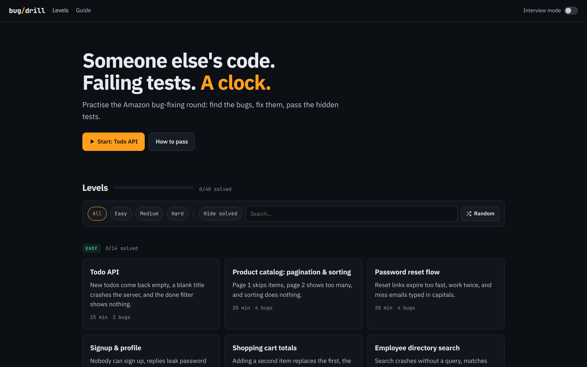
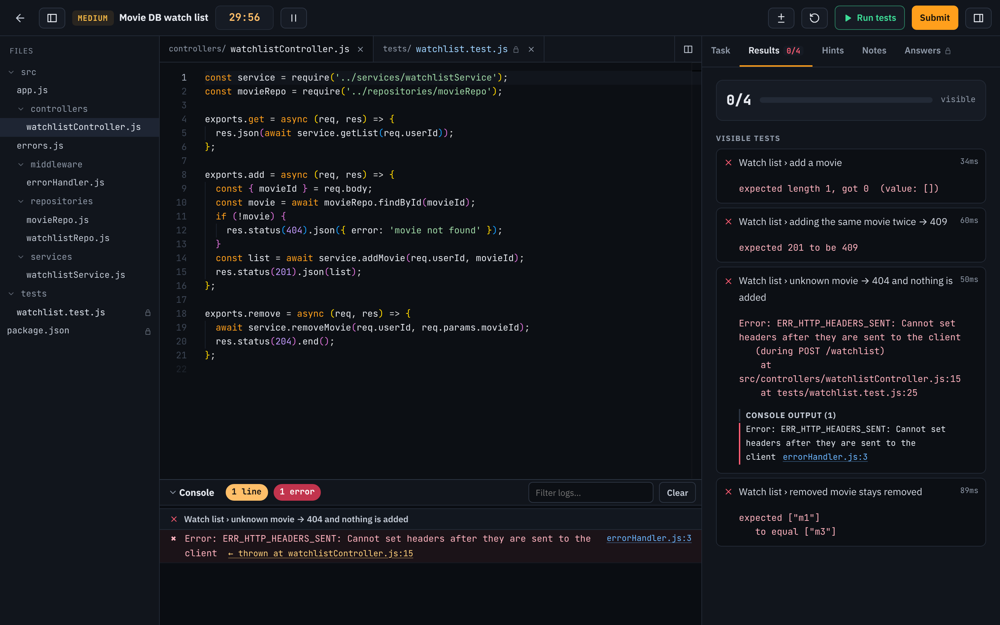

# bug/drill

**Practise the Amazon bug-fixing round before it counts.**

Someone else's code. Failing tests. A clock. That's the round. bug/drill lets you do it 40 times first, in your browser, for free.

**[Start practising at bug.visalan.me →](https://bug.visalan.me)**



## What you get

- **40 real-feeling apps.** Small Node/Express services with planted bugs: carts, bank transfers, rate limiters, job queues. 14 easy, 14 medium, 12 hard.
- **Tests that run in your browser.** Edit the code, press Run, see what passes. No install, no account, no server.
- **Hidden tests, like the real thing.** Passing the visible tests isn't enough. Submit to find out if your fix really holds.
- **A clock.** Each level has a time limit, so you learn to work at test speed.
- **Hints when you're stuck.** One small nudge at a time, then the answer if you want it.
- **Interview mode.** No hints, no tips, no answers until you pass. Just you and the code.
- **A guide that teaches the method.** A 60-minute plan, the bugs that show up again and again, and how to think about hidden tests.



## Why

The bug-fixing round isn't about writing code from scratch. It's about reading code you've never seen, finding what's wrong fast, and fixing it without breaking something else. That's a skill, and skills need practice. LeetCode doesn't train it. This does.

## Your progress stays with you

Solved levels, notes, code and best times are saved in your browser. Nothing is sent anywhere.

## Run it yourself

```bash
npm install
npm run dev
```

Open the link it prints. Needs Node 20 or newer.

## Add or check a level

Each level is a folder in `levels/<id>/`:

| File             | What it is                                     |
| ---------------- | ---------------------------------------------- |
| `meta.json`      | Title, time limit, the bugs, hints and answers |
| `ticket.md`      | The task the player reads                      |
| `repo/`          | The buggy app and its visible tests            |
| `hidden.test.js` | Tests that run on Submit                       |
| `solution/`      | The files the fix changes                      |

Every level must fail on the buggy code and pass with the fix. CI checks this on every push.

```bash
npm run verify            # check all levels
npm run verify -- m3 -v   # check one level, show every test
```

## A note on spoilers

The answers are in this repo, so you can read them if you want to. The site itself keeps them out of the page until you ask, so you can't spoil a level by accident.

## Contributing

Found a bug in a bug? Have an idea for a level? Open an issue or a pull request.
